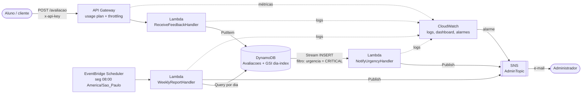
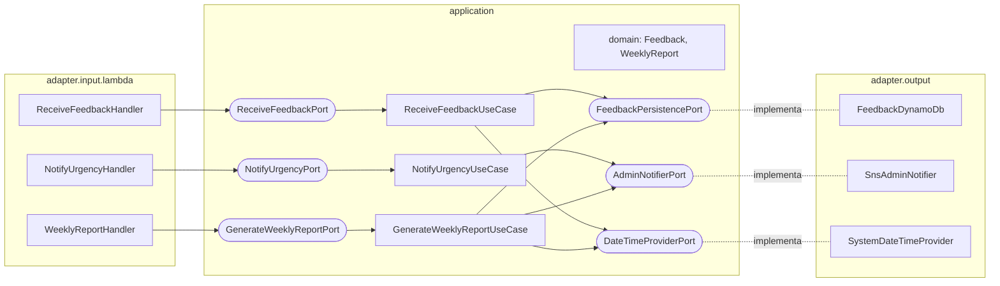

# Arquitetura

## Visão de nuvem

## Visão hexagonal (por função)

## Fluxos

1. **Recebimento:** a API chama o `ReceiveFeedbackHandler`, que converte o corpo HTTP e
   chama o `ReceiveFeedbackUseCase`. O domínio valida, classifica a urgência e o adapter
   do DynamoDB grava o item.
2. **Urgência:** cada gravação gera um evento no stream. O filtro do event source só
   entrega inserts com `urgencia = CRITICAL` ao `NotifyUrgencyHandler`, que chama o
   `NotifyUrgencyUseCase` e envia o e-mail pelo SNS.
3. **Relatório semanal:** o Scheduler aciona o `WeeklyReportHandler` toda segunda às 08:00.
   O `GenerateWeeklyReportUseCase` consulta o índice `dia-index` (uma Query por dia),
   consolida o `WeeklyReport` e envia o e-mail.
4. **Monitoramento:** logs em JSON com retenção de 7 dias, dashboard e alarmes. Qualquer
   alarme (erros das funções, 5xx da API) envia e-mail ao admin.
